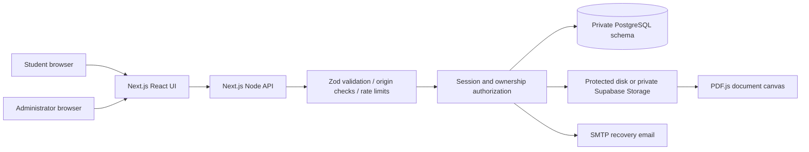
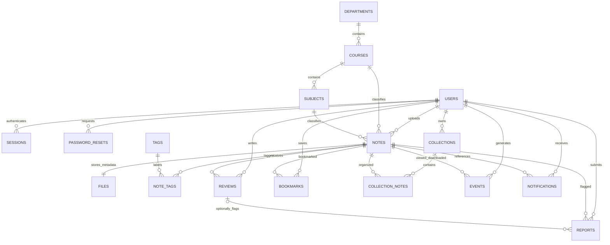
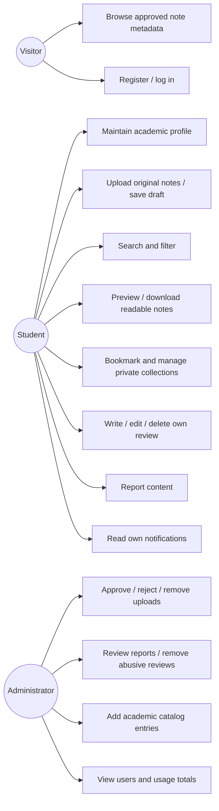
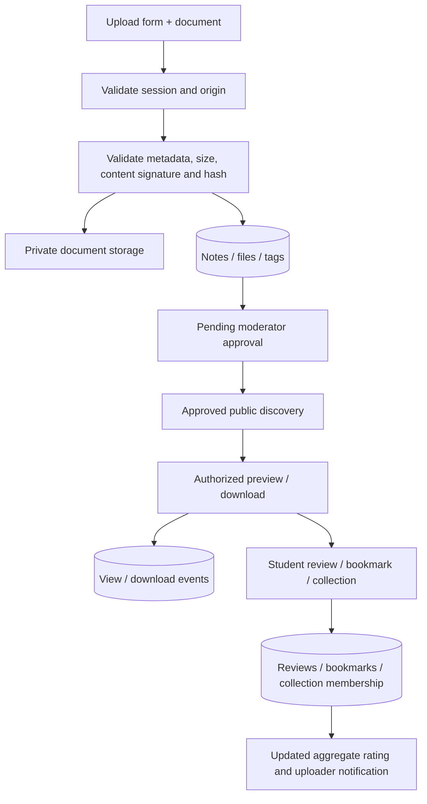

# NoteSphere — Smart Student Notes Sharing Platform

## Abstract

NoteSphere is a web application that centralizes academic notes and makes them searchable, previewable and reusable. Students upload PDFs for administrator approval; administrators can also publish PDFs directly to registered students. Students create profiles, discover material using academic filters, read PDFs in the browser, write reviews and organize private libraries. Administrators manage accounts, content and reports. The implementation combines a responsive Next.js interface with PostgreSQL, session-based authentication and access-controlled document storage. It supports an embedded PostgreSQL mode for classroom demonstrations and an external PostgreSQL/private cloud-storage mode for hosted operation.

The latest role-specific requirements and implemented permission model are documented in [Administrator and student workflows](ROLE-PORTALS.md). Current uploads are PDFs; student submissions require administrator approval, and all note access requires authentication.

## Problem statement

Academic notes are often distributed across chat groups, individual drives and informal class networks. Students struggle to find the correct subject or semester material, judge usefulness, retain useful documents and locate them again. Contributors have limited feedback and institutions have little control over inappropriate or unauthorized uploads.

## Objectives

1. Provide a centralized, searchable repository of authorized academic notes.
2. Personalize discovery using a student’s course and semester.
3. Support secure document contribution and in-browser PDF reading.
4. Enable constructive feedback through one editable rating/review per student per note.
5. Persist bookmarks and private collections across sessions.
6. Enforce authentication, ownership and administrative moderation on the server.
7. Deliver a maintainable, responsive application and reproducible setup suitable for faculty demonstration.

## Scope

The delivered core covers registration/login, student profile editing, notes upload and approval, academic discovery, PDF preview, downloads, bookmarks, collections, reviews, reports, notifications, dashboard aggregates and an admin console. Documents are PDF, DOCX or PPTX; Office documents use download fallback. Exact reading-page synchronization, OCR, semantic AI search, paid resources and institutional SSO are outside this version’s scope.

## Existing and proposed system

| Aspect | Typical informal system | NoteSphere |
| --- | --- | --- |
| Storage | Scattered messages and drives | Central document metadata and controlled storage |
| Discovery | Manual scrolling and asking classmates | Indexed text search and combined academic filters |
| Reuse | Files repeatedly forwarded | Unique bookmarks and personal collections |
| Feedback | Unstructured chat comments | Persistent student reviews and aggregated ratings |
| Access | Uncontrolled links | Session checks, ownership and private note visibility |
| Moderation | Ad hoc deletion | Pending approval, reports and admin permissions |

## Requirements

### Functional

FR1: Register students and securely authenticate/log out. FR2: Edit academic profiles and avatars. FR3: Upload validated documents and metadata. FR4: Discover approved public notes with conjunctive filters and search. FR5: Preview PDFs and download authorized documents. FR6: Save unique bookmarks and private collections. FR7: Create/update/delete the student’s own review while preventing self-review. FR8: Aggregate ratings from actual reviews. FR9: Record reading/download events. FR10: Notify uploaders about reviews and moderation. FR11: Report content. FR12: Restrict moderation, user listing and catalog additions to administrators. FR13: Recover accounts through expiring single-use email tokens when SMTP is configured.

### Non-functional

Security: hashed passwords/tokens, HttpOnly cookies, server authorization, origin checks, parameterized SQL, private storage and validation. Usability: responsive layout, clear navigation, readable text and useful error/empty states. Reliability: PostgreSQL constraints/cascades, bounded inputs, migration files and reproducible dependencies. Maintainability: separated UI, validation, database, storage and authorization modules. Performance: indexed metadata/full-text queries, debounced search, bounded pagination and aggregate queries appropriate for the project scale. Accessibility: labels, keyboard focus, icon-button names and reduced-motion CSS. Large deployment capacity has not been load-tested.

## Software and hardware

Development: Node.js 24 LTS, npm, current Chrome/Edge/Firefox, Windows/macOS/Linux. Optional Docker with PostgreSQL 17+. Production: Vercel Node runtime plus hosted PostgreSQL and private cloud Storage, or a Node host with persistent volumes and PostgreSQL. SMTP is required for email recovery. A practical development machine has at least 4 GB RAM and several GB free disk space for dependencies and build artifacts. These are development recommendations, not measured minimums.

## Architecture

The application database is not a browser-facing Data API. Tables live in a private `notesphere` schema, with RLS enabled and PUBLIC privileges revoked. The trusted server uses its database credential and enforces current identity and ownership for each operation. Storage authorization occurs before streaming locally or issuing a short-lived cloud URL. User-editable profile fields never grant administrative authority.

## Database schema and ER diagram

| Relation | Main fields and constraints |
| --- | --- |
| users | UUID, unique normalized email, password hash, profile fields, constrained role, timestamps |
| sessions / password_resets | Token hash PK, user FK, expiry; raw tokens are not stored |
| departments / courses / subjects | Reference IDs, unique names, academic parent FKs |
| notes | Owner FK, catalog FKs, academic metadata, semester/status/visibility checks, timestamps |
| files | Note FK/PK, unique storage key, original name, MIME, bytes, SHA-256 |
| tags / note_tags | Unique tag name; composite relationship PK |
| reviews | Note/user FKs, unique note-user pair, 1..5 rating, bounded written review |
| bookmarks | Composite user-note PK; saved timestamp |
| collections / collection_notes | Owner FK, unique owner-name; unique collection-note pair |
| events | User/note FKs, constrained view/download kind and timestamp |
| notifications | Recipient/note FKs, message, read flag and timestamp |
| reports | Reporter/note FKs, optional associated review, reason/status/timestamp |
| rate_limits / migrations | Durable throttle windows and applied initial schema record |

Indexes cover owner access, note status/subject/semester, full-text document search, file hashes, reading events and notifications. Foreign-key cascades safely remove related records when a note/user is removed. A collection deletion removes membership only. Average ratings are derived from reviews, avoiding a separately mutable aggregate that could become stale.

## Use cases

## Data flow

## Implementation and security controls

The UI calls JSON/multipart API endpoints rather than trusting frontend state. Each write validates its origin and payload; ownership comes from the verified server session. Role values cannot be changed through profile requests. A student’s private collections cannot be retrieved or changed by another student, even with a known UUID. Pending/private files do not become public through download URLs. Cookies are HttpOnly/SameSite=Lax and Secure in production. Recovery consumes a token and updates credentials/revokes sessions in one SQL statement. Passwords use independently salted scrypt hashes and constant-time comparison.

API documentation is in `API.md`. Architecture decisions are in `ARCHITECTURE.md`. Setup, environment variables, migration, admin creation and run commands are in the root README. Hosted deployment is in `DEPLOYMENT.md`.

## Testing

The automated plan covers positive student journeys and negative authorization/validation cases. The HTTP suite uses a real production Next.js server, real PostgreSQL execution in PGlite, generated PDF fixtures, two students and an administrator. Its generated `TEST-RESULTS.md` records only completed assertions. Unit tests check salted hashes, password rejection, note visibility, validation and origin protection. Production build/typechecking and dependency audit are run separately. Browser rendering, SMTP delivery and cloud integrations must be reported independently and never inferred from HTTP tests.

## Future enhancements

Direct-to-private-storage resumable uploads; antivirus/content-disarm pipeline; metadata editing; exact reading-page synchronization; helpful review votes; contributor leaderboard; institution SSO/email verification; instructor verification; more academic catalogs; optional cover images; richer analytics; catalog editing and semester administration; accessible focus-trapped dialogs; end-to-end browser automation; load testing; automated retention and storage reconciliation.

## Conclusion

NoteSphere implements the central academic sharing workflow with persisted data and server-enforced permissions. It demonstrates a maintainable full-stack architecture, thoughtful student-focused design and reproducible testing. Hosted database, cloud Storage and SMTP configuration complete the infrastructure needed for a public deployment; optional growth features are documented separately from the working core.
